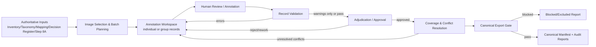
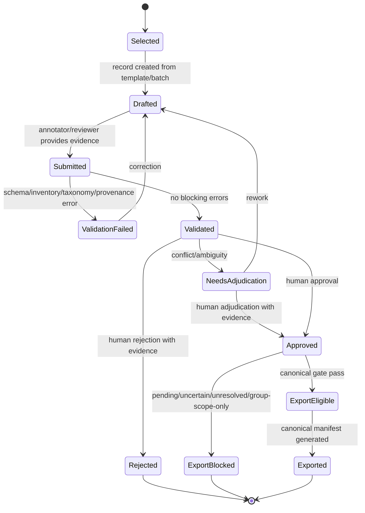

# Step 8B — B0 Architecture and Data Contract

- **Status:** B0 design deliverable (planning/design only; no implementation)
- **Date:** 2026-11-24
- **Scope approved:** B0 only — architecture, data contract, lifecycle, decision/validation rules
- **Inputs reviewed:** Step 8A schema/format/templates/validator/tests, `label_mapping_decisions.json`, approved taxonomy, folder-class mapping, Step 8B implementation proposal

## 1. Purpose and boundary

B0 defines the **final technical architecture and data contract** for structured multi-ingredient human recognition annotations in Step 8B. It does not implement scripts, modify existing Step 8A artifacts, or alter datasets/taxonomy/mappings.

**Objectives supported by this contract:**
- Multi-ingredient image recognition research with provenance-aware human annotations.
- Backward compatibility with Step 8A `human-recognition-v1`.
- Explicit separation of approved canonical labels, approved aliases, pending canonical mappings, uncertain labels, and out-of-scope labels.
- Protection against false ground truth: group confirmation is never auto-converted to individual image ground truth.

## 2. Design constraints and invariants

| ID | Invariant |
|---|---|
| INV-01 | Step 8A artifacts are read-only inputs; v1 schema/templates are not modified. |
| INV-02 | Master CSV, approved taxonomy, folder mappings, dataset images, backend/frontend are not modified by Step 8B B0. |
| INV-03 | Folder names and machine mappings are never ground truth. |
| INV-04 | `recognition_method=group` confirmation applies to group scope only; never auto-converted to individual image ground truth. |
| INV-05 | No fabrication of reviewer IDs, dates, decisions, or evidence. Unknown values remain null/empty per schema. |
| INV-06 | Pending canonical mappings remain pending until explicit human resolution evidence is recorded: `Garlic`/Gralic (599) and `Pepper Corn`/Paper Corn (216). |
| INV-07 | Canonical export is blocked for pending, uncertain-unresolved, invalid, or provenance-incomplete records. |
| INV-08 | Image identity linkage uses Step 6 `master_image_inventory.csv` as authoritative inventory; `image_id` is the stable key. |

## 3. Authoritative inputs (read-only)

| Input | Role | Authority |
|---|---|---|
| `annotation_pipeline/exports/master_image_inventory.csv` | Stable image identity, path, folder, filename, hash/provenance | Authoritative image linkage |
| `annotation_pipeline/config/approved_taxonomy.json` | Canonical in-scope/out-of-scope class IDs | Authoritative taxonomy |
| `annotation_pipeline/config/folder_class_mapping.json` | Folder proposals/candidates; not ground truth | Advisory only |
| `annotation_pipeline_step8a/config/label_mapping_decisions.json` | Approved aliases and pending canonical mapping decisions | Authoritative decision register for Step 8A/B0 mapping gates |
| `annotation_pipeline_step8a/config/human_recognition.schema.json` | v1 record contract | Backward-compatible baseline |
| Step 8A reports/master CSV | Historical verification context | Read-only evidence/context; not silently rewritten |

## 4. Architecture overview



### 4.1 Component responsibilities

| Component | Responsibility | B0 output |
|---|---|---|
| Input Registry | Resolve image IDs, taxonomy IDs, decision-register rules | Data contract references |
| Batch Planner | Select images/groups for annotation; record batch scope and exclusion rules | Batch manifest spec |
| Annotation Store | Store immutable JSON records (v1-compatible or additive v1.1) | Record layout spec |
| Validator | Schema, inventory, taxonomy, decision-gate, provenance, conflict checks | Validation rule catalog |
| Review/Approval | Human approval/rejection/adjudication with evidence | Lifecycle state rules |
| Coverage Engine | Per-image/folder/method/status coverage and pending exclusions | Coverage report spec |
| Export Gate | Emit canonical manifest only for eligible records | Export-blocking rules |

## 5. Annotation lifecycle



### 5.1 Lifecycle stages

| Stage | Entry criteria | Exit criteria | Blocking conditions |
|---|---|---|---|
| Selected | Image/group exists in inventory and batch scope | Draft record created | Missing inventory identity |
| Drafted | Template instantiated; no fabricated evidence | Submitted for validation | N/A |
| Submitted | Required fields present | Validation pass/fail | Missing required fields, malformed JSON |
| Validated | No blocking errors | Approved / NeedsAdjudication / Rejected | Blocking validation errors |
| NeedsAdjudication | Conflict or ambiguity detected | Approved or Drafted | Conflicting active records unresolved |
| Approved | Human approval with evidence; confirmed requires ground truth | ExportEligible or ExportBlocked | Pending canonical, group-scope-only for individual export, uncertainty unresolved |
| Exported | Canonical gate pass | Immutable report/manifest | Any export-blocking condition |

## 6. Annotation semantics

### 6.1 Individual annotation

- **Scope:** exactly one inventory image (`image_id`).
- **Use:** image-level human recognition evidence; only this scope can become individual image ground truth.
- **Required linkage:** `individual.image_id`, `relative_path`, `original_folder`, `original_filename` must match Step 6 inventory.
- **Multi-ingredient:** represented by multiple canonical labels in `ingredient_labels`; uncertain/out-of-scope separated into dedicated arrays.
- **Canonical eligibility:** possible only when confirmed, provenance-valid, taxonomy-valid, decision-gate pass, and no unresolved conflict.

### 6.2 Group annotation

- **Scope:** a folder/group/batch inspected together; may cover multiple `image_ids`.
- **Use:** historical or batch evidence where per-image individual inspection is not proven.
- **Required linkage:** `group.group_id`, `original_folder`, `proposed_ingredient`, `image_ids`, `image_count`; all IDs must exist in inventory.
- **Critical rule:** **Group confirmation never automatically becomes individual image ground truth.** A confirmed group record can support group-level reporting/exclusion but cannot be expanded into per-image canonical labels without individual image-level evidence records.
- **Canonical eligibility:** not eligible for individual-image canonical manifest export by default. May be eligible only for group-scope audit/report outputs.

## 7. Stable image and annotation record linkage

### 7.1 Image identity

- **Stable primary key:** `image_id` from `master_image_inventory.csv` (`IMG-000001` style).
- **Secondary checks:** `relative_path`, `original_folder`, `original_filename`, optionally `sha256`.
- **Path normalization:** validator compares normalized paths (`/` vs `\`), but records should store canonical relative path from inventory.

### 7.2 Annotation record identity

- **Primary key:** `record_id` (globally unique within Step 8B store).
- **Recommended convention:** `HR-IND-<batch>-<seq>` / `HR-GRP-<batch>-<seq>`; immutable after approval.
- **Versioning:** corrections create a new record with `supersedes_record_id` (additive field in v1.1 policy; v1 records remain valid). Old record status becomes `rejected` or `superseded` by policy, never silently edited in place after export.

### 7.3 Linkage rules

| Rule | Description |
|---|---|
| LNK-01 | Every individual record references exactly one existing inventory `image_id`. |
| LNK-02 | `image_id`, `relative_path`, `original_folder`, `original_filename` must all match the same inventory row. |
| LNK-03 | Every group `image_id` must exist in inventory; `image_count == len(image_ids)`. |
| LNK-04 | Group `image_ids` should belong to declared `original_folder`; exceptions require explicit evidence and warning/error by policy. |
| LNK-05 | No record may reference images absent from inventory or outside collected dataset scope. |
| LNK-06 | Active records for same image must be conflict-checked before approval/export. |

## 8. Canonical label approval and pending-mapping restrictions

### 8.1 Label classes

| Class | Meaning | Canonical export |
|---|---|---|
| Approved canonical | In-scope canonical taxonomy ID with valid evidence | Allowed if all gates pass |
| Approved alias | Display label mapped to canonical ID by decision register (e.g., `Curry Leaf` -> `curry_leaves`) | Allowed only as resolved canonical ID; preserve display label in audit fields |
| Pending canonical mapping | Display/folder label has no approved canonical ID yet | **Blocked** from canonical approval/export |
| Out-of-scope canonical | Taxonomy out-of-scope ID | Reportable; excluded from in-scope training manifest unless explicitly configured |
| Uncertain | Human cannot confidently assign canonical label | Blocked from canonical positive export |

### 8.2 Decision register enforcement

`label_mapping_decisions.json` is authoritative for Step 8A/B0 mapping decisions:

| Folder | Observed label | Records affected | Decision | Canonical ID | Rule |
|---|---|---:|---|---|---|
| Curry Leavf | Curry Leaf | 114 | `approved_alias` | `curry_leaves` | Alias may be resolved to canonical ID; preserve original display label. |
| Gralic | Garlic | 599 | `pending_canonical_mapping` | `null` (candidate `garlic_clove`) | **Preserve pending.** Do not auto-map to `garlic_clove`. No canonical approval/export. |
| Paper Corn | Pepper Corn | 216 | `pending_canonical_mapping` | `null` (candidates `black_pepper_whole`, `black_pepper_ground`) | **Preserve pending.** Do not split/map. No canonical approval/export. |

### 8.3 Pending-mapping gate

- Any record/image/label resolution touching Garlic(599) or Pepper Corn(216) remains `canonical_mapping_pending=true` until an explicit human resolution record is approved.
- Resolution requires: evidence-backed human decision, scope (image/group), reviewer/date or documented historical evidence, and decision-register update in a future approved step (not B0).
- Pending mappings may appear in coverage/exclusion reports, never in canonical-approved training manifests.

## 9. Duplicate detection, conflict resolution, and coverage

### 9.1 Duplicate detection

| Duplicate type | Detection | Default handling |
|---|---|---|
| Record ID duplicate | Same `record_id` across files/store | Blocking error |
| Exact record duplicate | Same image scope + same labels/status/provenance hash | Warning; dedupe candidate |
| Duplicate image in group | Repeated `image_id` in `group.image_ids` | Schema/validation error |
| Duplicate active individual records | Multiple active records for same `image_id` | Blocking conflict until adjudicated |
| Overlapping group records | Same image covered by multiple groups with incompatible labels/status | Warning/conflict by policy |

### 9.2 Conflict resolution

- **Conflicts require adjudication** before approval/export: label disagreement, status disagreement, scope disagreement, or pending/canonical contradiction.
- **Adjudication output:** new approved record or explicit rejection/supersession; preserve prior records for audit.
- **No silent merge.** Multi-label union is allowed only when evidence supports co-occurrence; otherwise adjudicate.
- **Group vs individual conflict:** individual image-level evidence overrides group assumption for that image, but does not rewrite group record; group remains group-scope evidence.

### 9.3 Coverage model

Coverage must be reported at image and folder levels:

| Coverage status | Definition |
|---|---|
| `uncovered` | No human recognition record |
| `group_only` | Covered by group record(s) only; no confirmed individual image evidence |
| `individual_pending` | Individual record exists but not confirmed/eligible |
| `individual_confirmed_canonical` | Confirmed individual record passes canonical gates |
| `pending_canonical_mapping` | Mapped to pending decision-register case; excluded from canonical approval |
| `out_of_scope` | Confirmed out-of-scope only |
| `conflicted` | Active conflicting records unresolved |

Coverage reports must include the 815 pending-canonical exclusions as explicit rows/summary counts.

## 10. Validation rules: errors, warnings, export-blocking conditions

### 10.1 Blocking errors (validation fails)

| Code | Condition |
|---|---|
| E-SCHEMA | JSON/schema invalid, missing required field, invalid enum/pattern/type, additional property. |
| E-LINK | `image_id`/path/folder/filename mismatch or missing from master inventory. |
| E-TAXONOMY | Label not in approved taxonomy. |
| E-TAXONOMY-PLACEMENT | Out-of-scope ID placed in `ingredient_labels`, or in-scope ID placed in `out_of_scope_labels` (Step 8B policy). |
| E-GROUP-COUNT | `group.image_count != len(image_ids)`. |
| E-PROVENANCE | `verification_status=confirmed` but `is_human_ground_truth!=true` or evidence summary/reference missing. |
| E-DUPLICATE-ID | Duplicate `record_id`. |
| E-CONFLICT | Conflicting active records for same image scope without adjudication. |
| E-FABRICATION-RISK | Record asserts fabricated/unsupported historical certainty (policy check; e.g., confirmed without evidence). |

### 10.2 Warnings (validation passes with review)

| Code | Condition |
|---|---|
| W-GROUP-CONFIRMED | Confirmed group record: cannot be converted to individual ground truth. |
| W-MISSING-DATE | Confirmed historical record missing `recognition_date`; preserved as unknown. |
| W-GROUP-FOLDER-MISMATCH | Group image IDs span folders inconsistent with `original_folder`. |
| W-PENDING-MAPPING | Record touches pending canonical mapping; excluded from canonical export. |
| W-AMBIGUOUS-LABEL | Labels present in `uncertain_labels` or ambiguous provenance. |
| W-DUPLICATE-CONTENT | Potential duplicate record content. |

### 10.3 Export-blocking conditions

| Code | Condition | Effect |
|---|---|---|
| X-PENDING-CANONICAL | Any label/scope under pending canonical mapping (`Garlic` 599, `Pepper Corn` 216) | Exclude from canonical manifest |
| X-GROUP-SCOPE | Group record, or group-derived label without individual image evidence | Exclude from individual ground-truth export |
| X-UNRESOLVED-UNCERTAIN | Uncertain labels unresolved for canonical positive use | Exclude or export as non-canonical only |
| X-INVALID | Any blocking validation error | Exclude |
| X-CONFLICT | Unadjudicated conflict | Exclude |
| X-PROVENANCE-INCOMPLETE | Confirmed record missing required evidence fields | Exclude |
| X-NOT-CONFIRMED | Status not confirmed | Exclude from canonical-approved manifest |

## 11. Output formats and directory structure

### 11.1 B0 outputs (this stage)

```text
research/phase-13.3/annotation_pipeline_step8b/
  planning/
    step8b_implementation_proposal.md
  b0/
    B0_architecture_and_data_contract.md
    B0_data_contract.md
    B0_lifecycle_diagram.md
    B0_decision_and_validation_rules.md
```

### 11.2 Future implementation outputs (B1+, not created now)

```text
research/phase-13.3/annotation_pipeline_step8b/
  config/
    human_recognition_v1_1.schema.json        # additive only; v1 unchanged
    step8b_validation_policy.json
    annotation_batches.json
  records/
    individual/
    group/
    adjudicated/
  reports/
    validation/
      step8b_validation_report.json
      step8b_validation_report.md
      step8b_record_conflicts.csv
    coverage/
      step8b_image_coverage.csv
      step8b_folder_coverage.csv
      step8b_pending_canonical_exclusions.csv
    exports/
      step8b_canonical_manifest.csv
      step8b_excluded_records.csv
  scripts/
  tests/
```

### 11.3 Format rules

- **Records:** JSON, UTF-8, one record per file for immutable auditability; optional JSONL for batch export.
- **Reports:** CSV for tabular audit, Markdown for human review, JSON for machine-readable summary.
- **Manifests:** CSV/JSON with `image_id`, `relative_path`, `record_id`, `recognition_method`, `verification_status`, `canonical_labels`, `display_labels`, `mapping_status`, `provenance_ref`, `export_eligible`, `exclusion_reason`.
- **Diagrams:** Mermaid in Markdown for version control.

## 12. Backward compatibility with Step 8A

- Step 8A `human-recognition-v1` records remain valid inputs.
- v1 schema and templates remain unchanged; any v1.1 extension must be additive and optional for v1 records.
- Step 8A decision register is consumed read-only; future updates require explicit approved process.
- Step 8A master CSV remains historical/read-only; Step 8B uses additive records/reports.
- Existing validator/tests remain baseline; Step 8B adds separate tests without breaking v1 behavior.

## 13. B0 completion statement

B0 defines the architecture, data contract, lifecycle, and decision/validation rules for Step 8B. No annotation scripts were implemented; no existing schemas/templates/master CSV/taxonomy/mappings/images/backend/frontend were modified; all new files are inside `research/phase-13.3/annotation_pipeline_step8b/b0/`.