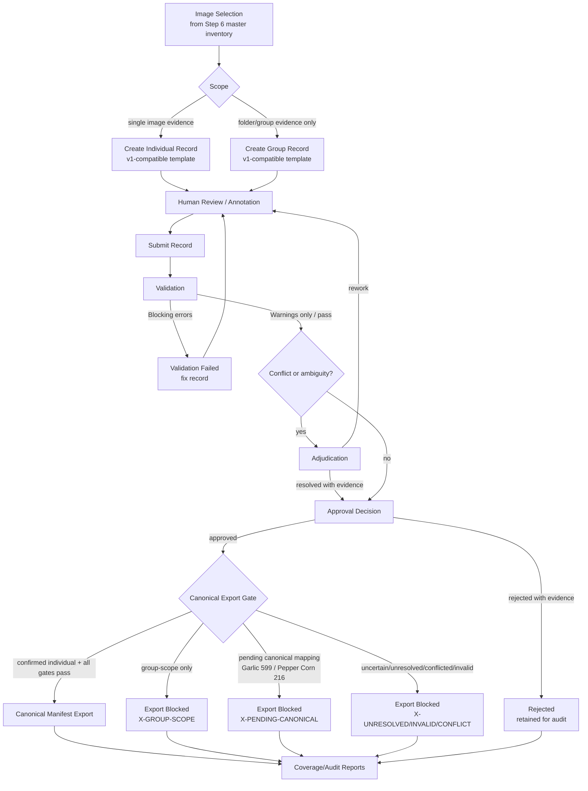
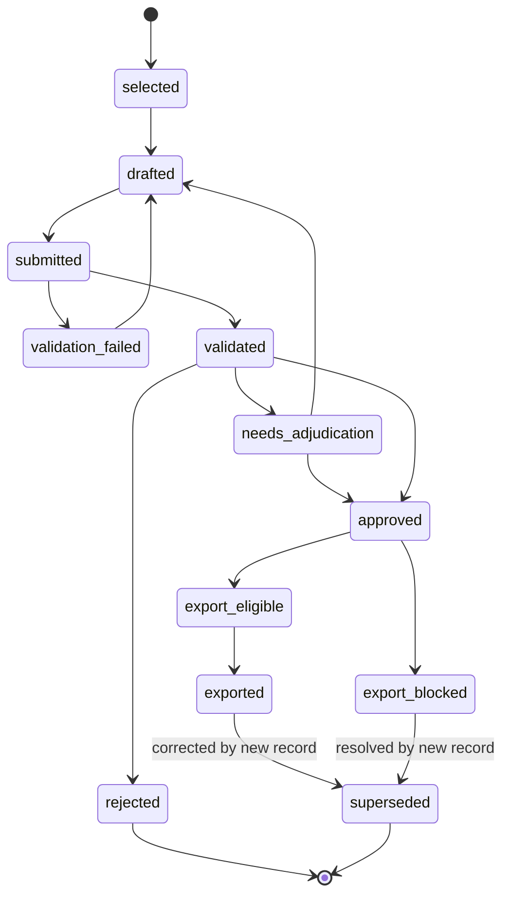
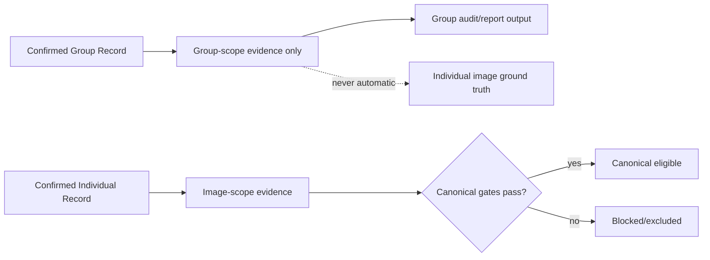
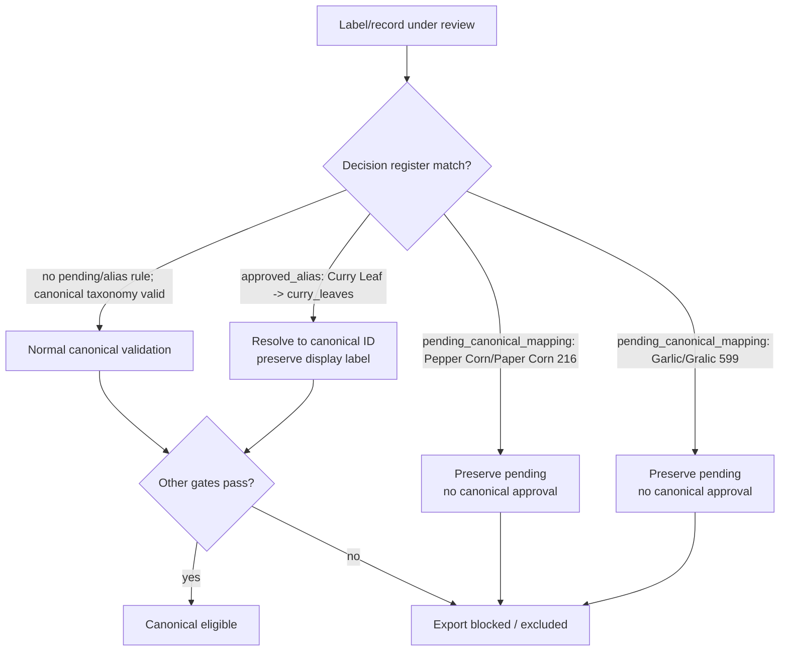

# Step 8B — B0 Annotation Lifecycle Diagram

- **Status:** B0 design deliverable
- **Date:** 2026-11-24

## 1. End-to-end lifecycle

## 2. Record state model

## 3. Group vs individual semantics

## 4. Pending canonical mapping gate

## 5. Lifecycle gate summary

| Gate | Pass condition | Fail effect |
|---|---|---|
| Schema/inventory/taxonomy | Valid v1-compatible record, known inventory IDs, valid taxonomy IDs | Validation failed |
| Provenance | Confirmed records have human ground truth and evidence | Validation failed / export blocked |
| Conflict | No unresolved active conflicts for same image scope | Needs adjudication / export blocked |
| Pending mapping | No pending canonical mapping in canonical approval path | Export blocked, reported as pending |
| Scope | Individual image evidence exists for individual ground truth | Group records excluded from individual export |
| Final export | All gates pass | Canonical manifest row emitted |